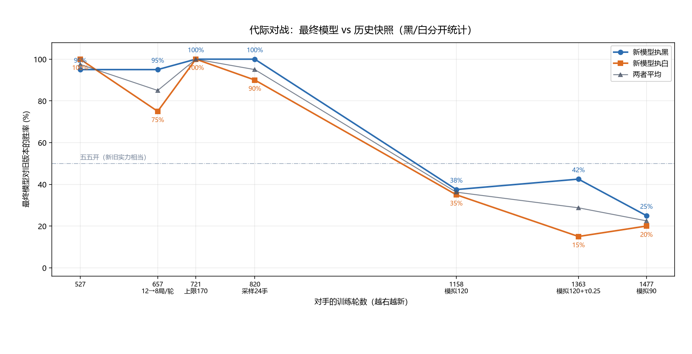
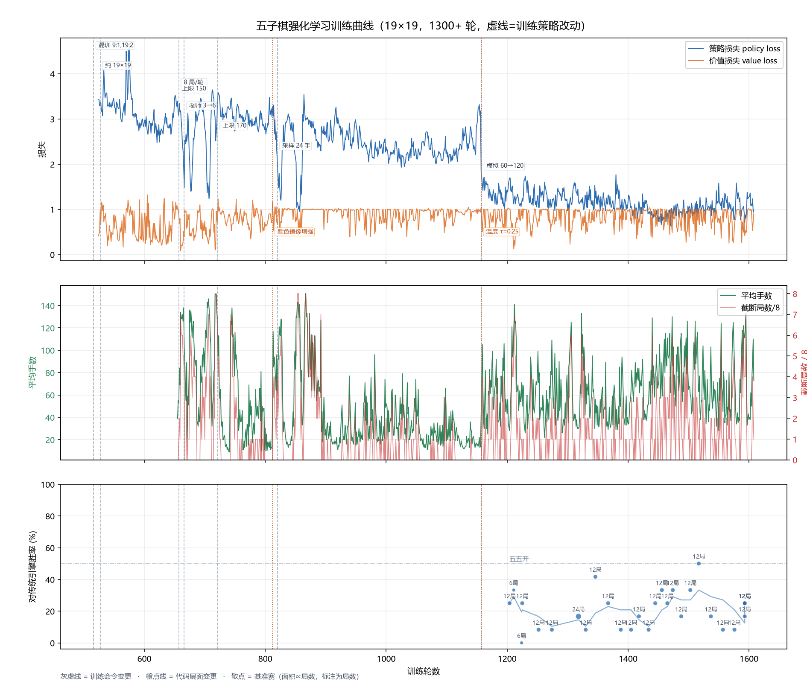
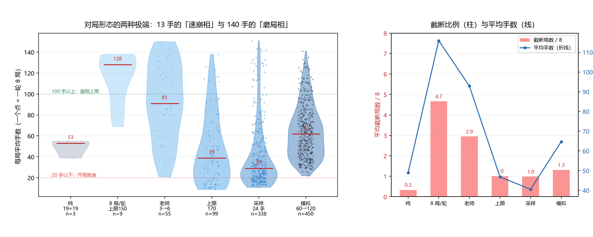

# 五子棋：传统搜索与强化学习双引擎 —— 项目报告

> 课程：数据结构与算法（2026 秋）　姓名：**<你的名字>**　院系：**<你的院系>**
> 项目名称：Gomoku 双引擎五子棋
> 仓库地址：**https://github.com/ningxling/Gomoku**
> 提交版本：**v1.2**（tag），交付权重 `iter 2358`（128 通道）

---

## 1. 项目概述

面向"想下一盘五子棋、又想看看不同 AI 谁更强"的场景，实现了一个浏览器里可玩的五子棋项目：

- **传统搜索引擎**：α-β 迭代加深 + 棋型评估 + 威胁表 + VCF 算杀 + 禁手判定，纯 Python 手写；
- **强化学习引擎**：AlphaZero 风格（策略价值网络 + PUCT MCTS + 自我对弈），**119 万参数**（128 通道）；
- **三种对局模式**：人人对战、人机对战（可选引擎）、传统 vs 强化自动观战；
- **训练流水线**：远程训练、权重回传、基准赛、健康监控、权重存档。

选择它的理由是：五子棋同时适合**经典搜索**（能把手写的 α-β 做到可量化的强度）和**学习和搜索结合**
（AlphaZero），两者放在同一界面里对比，能把课程里的搜索、剪枝、哈希、树结构一次讲清楚。

---

## 2. 核心设计（课程知识）

### 2.1 数据结构：长度-5 窗口 + 三进制编码

19×19 在 4 个方向共 **1020 个"长度 5 的窗口"**，每个窗口用 5 位三进制编码（0 空 / 1 黑 / 2 白），
编码值 0~242 直接当作查表下标：

| 表 | 用途 |
| --- | --- |
| `_TB[243]` / `_TW[243]` | 窗口分值：成五 10⁷、四 2000、活三 200、二 20 |
| `_FOUR_MASK[243]` | 该窗口是否"4 子 + 1 空"（即存在成五点） |

**关键性质**：落子只影响 20 个窗口（4 方向 × 5），所以评估是 **O(20) 增量更新**，不需要重扫棋盘。
这就是纯 Python 也能跑到 1~2 万节点/秒的原因。

### 2.2 威胁表：把"强制着法"从搜索里摘出来

维护 `tcnt[player]`：记录"哪些空点能让该方下一手成五"。窗口变成"4 子 + 1 空"时对空位 +1，
破坏时 -1。于是每个节点 O(1) 判断：

- 自己有冲四点 → 直接判必胜，不搜索；
- 对方有冲四点 → 只能挡（唯一挡点只搜一手）。

### 2.3 搜索

negamax + α-β + 置换表（Zobrist，EXACT/LOWER/UPPER）+ 迭代加深（2→10 层，超时回退）+
候选点按"进攻分 + 0.9×防守分"排序 + 叶子节点强制着法延伸 + VCF 连续冲四算杀。

### 2.4 复杂度

| 操作 | 代价 |
| --- | --- |
| 落子 / 撤销 | O(20) |
| 静态评估 | O(1) |
| 单点排序分 | O(20) |
| 威胁表维护 | O(40) |
| 单节点总体 | 约 50~80 μs（实测 1.2~2 万节点/秒） |

---

## 3. 实验与结果

### 3.1 消融实验：三个部件各值多少

19×19、限时 0.3 秒、3 个安静开局取平均；9×9 快棋 0.05 秒/手、各 8 局交替先后手。
完整脚本：`tools/ablation_engine.py`，输出：`docs/ablation_result.md`。

| 配置 | 平均深度 | 节点数 | 耗时 | 对完整版胜率 |
| --- | ---: | ---: | ---: | ---: |
| 完整版 | **5.0** | 5,973 | 312 ms | — |
| 去掉置换表 | 5.0 | 5,888 | 307 ms | 38% |
| 去掉 VCF | 5.0 | 6,059 | 306 ms | 50% |
| 去掉威胁表 | **2.7** | 2,901 | 313 ms | **25%** |

**结论**

1. 威胁表贡献最大：同样 0.3 秒，深度从 5.0 掉到 2.7，胜率掉到 25%。它砍掉的是"必须应"的分支。
2. 置换表在这个深度下**没有可测收益**（5973 vs 5888 节点）——诚实记录：它的价值要在更深搜索中体现。
3. VCF 只影响"能否算出强制胜"（战术表里唯一失效项），对 9×9 快棋胜率影响不大。

### 3.2 强化学习 vs 传统引擎

19×19、每局随机 4 手开局、网络 60 次模拟、传统引擎 0.1 秒/手：

| 训练轮数 | 局数 | 网络胜 | 胜率 |
| --- | ---: | ---: | ---: |
| 1204 | 12 | 3 | 25% |
| 1318 | 24 | 4 | 17% |
| 1456 | 12 | 4 | 33% |
| 1517 | 12 | 6 | 50% |
| 1557 | 12 | 1 | 8% |
| 1593 | 12 | 3 | 25% |
| **累计** | **300** | **61** | **20.3%** |

单次 12 局的波动极大（8%~50%），所以只看累计值：**300 局 61 胜 = 20.3%**。

> 注：这一档测的是 1608 轮附近的模型（当时的最终版）。后来发现 1477 轮更强，
> 64 通道这条线的最高水平是 **29~33%**（48 局基准，见 3.7 节）。
训练于 2026-10-24 停在 1608 轮（约 1.3 万局自我对弈），10-28 从 1477 续训并加入代际闸门（见 3.5 节）。**交付权重不是最后一版**：最终轮反而不如 1477，已回退到 1477。
训练期间 policy loss 从 3.1 降到 0.74，但对传统引擎的胜率**始终停在 20% 附近**——
这是本项目最重要的一个结论：**损失下降不等于棋力提升**。

### 3.3 三组干预实验（都是负结果）

发现"输局里一半以上在最后 3 手内漏挡过活三"后，试了三组局部规则来补：

| 干预 | 机制 | 同一批 16 局 | 漏挡活三 | 结论 |
| --- | --- | ---: | ---: | --- |
| 无（基线） | 纯 MCTS | 1 胜 | 8 次 | — |
| 战术兜底 | 强制着法（成五/挡四/VCF）交给传统引擎直接走 | 2 胜 | 11 次 | 无效 |
| 活三护栏 | 对手有活三时只允许在挡点里选 | 0 胜 | **0 次** | 机制有效、收益为零 |
| 活三护栏 + 自方反击点 | 允许"挡的同时保留自己成四的点" | 0 胜 | 4 次 | 无效 |

**结论**：护栏确实能把"漏挡活三"从 8 次降到 0 次，但**胜场没有变化**——说明挡住活三之后，
引擎还能用双三、四三、VCF 继续赢。**差距不在某个局部规则，而在整体的形势判断**。
这三组干预最终都默认关闭，代码保留在 `tactics.py` / `teacher.py` 里供复现。

### 3.4 代际对战：训练并不是单调变强的

停机后做了一件更严格的评估——**让最终模型（1608 轮）去挑战自己的历史版本**，
每个对手 40 局（先手 20、后手 20，每局随机 4 手开局）：

| 对手轮数 | 执黑 | 执白 | 合计 |
|---|---:|---:|---:|
| 527（纯 19×19 初期） | 95% | 100% | 97.5% |
| 721（上限 170） | 100% | 100% | 100% |
| 820（采样 24 手） | 100% | 90% | 95% |
| 1158（模拟 120） | 37.5% | 35% | **36%** |
| 1363（模拟 120+τ0.25） | 42.5% | 15% | **29%** |
| 1477（模拟 90 起点） | 25% | 20% | **22.5%** |



**对 820 及以前几乎全胜，对 1158 之后反而打不过**——说明训练在 1158 轮附近达到了峰值，
之后退化。进一步的三代循环赛给出排名 **1477 > 1363 > 1158**，
再用同一批 24 个开局对传统引擎验证：

| 权重 | 对传统引擎 |
|---|---:|
| **iter 1477** | **42%（10 胜 14 负）** |
| iter 1608 | 8%（2 胜 22 负） |

于是**交付权重回退到 1477**。这是本报告最重要的一个教训：
**"最新"不等于"最强"；只看对固定对手的胜率会被噪声掩盖，只有让模型和自己比才能发现退化。**

### 3.5 续训与代际闸门（防止再次退化）

确定 1477 最强之后，10-28 从它续训，并把模拟次数改回 120（1457 那代用的配置），
同时补了一套**训练/部署分离**的机制：

| 机制 | 做法 |
|---|---|
| 训练 | 永远写 `latest.pt`，模型持续漂移、不停探索 |
| 部署 | 读 `best.pt`，线上不会用到更差的版本 |
| 代际评估 | 每 50 轮：最新 vs 最佳，40 局（黑白各 20，随机 4 手开局） |
| 提升条件 | 胜率达到 **55%** 才把最新提升为最佳 |
| 退化报警 | 连续 3 次低于 50% → 写 `gate_alert.txt` |
| 饱和判定 | 连续 5 次落在 50%±5% → 标记饱和，提示该改结构而不是继续堆轮数 |

这样"模型必须一直动"和"线上不能退步"两个目标就不再冲突——
之前的教训正是因为没有这一层，直接拿最新权重上线，才让 1608 的退化影响了交付。

**第一次闸门评估（2026-10-29 00:29，1528 轮）：**

| 最新 | 最佳 | 局数 | 结果 | 动作 |
|---|---:|---:|---|---|
| iter 1528 | iter 1477 | 40 | 16 胜 24 负 = **40%** | 拒绝替换，`best.pt` 仍是 1477 |

也就是说：**从 1477 续训 50 轮后并没有变得更强**（40%，低于 50% 的分界）。
闸门按设计挡住了这次替换，线上权重保持 1477。

后续两次评估印证了"先掉后升"：

| 时间 | 最新 | 结果 | 动作 |
|---|---|---:|---|
| 00:29 | 1528 | 40.0% | 拒绝 |
| 07:18 | 1578 | 42.5% | 拒绝（连续低迷 2 次） |
| **15:10** | **1628** | **61.3%** | **提升为最佳** |

**但提升之后出现了一次很有教育意义的误判。** 先用 24 局测 1628 对传统引擎，只赢 4 局（17%），
而 1477 在同一批 24 局里是 42%——看起来"自对弈变强、外部变弱"。

于是立刻回退到 1477，并给闸门加了"外部基准"这第二道检验。
**但用 36 局复测后，两版成绩完全相同：**

| 权重 | 对传统引擎（36 局，同一批开局） |
|---|---:|
| 1477 | 12 胜 24 负 = **33%** |
| 1628 | 12 胜 24 负 = **33%** |

也就是说，42% 与 17% 的差距**是 24 局小样本的噪声**（两者的置信区间本来就重叠）。
这是本项目第二次被小样本骗到（第一次是"6 局其实是同一盘棋"）：

> **评估一个 20~40% 水平的模型，24 局远远不够。** 要把误差压到 ±8% 以内，
> 至少要 36~60 局；要区分 5 个百分点的差异，需要上百局。

外部基准这道检验仍然保留（它能挡住真正的退化，比如 1608 那种 8%），
后来统一为 **48 局、容差 7 个百分点**（见 3.7 节的第五次样本量教训）。

### 3.6 一个方法论错误（值得记录）

早期基准赛用 6 局，出现"16.7% 胜率"。后来发现两个 agent 都是确定性的，
**6 局其实是同一盘棋重复 3 遍**（执黑 3 局、执白 3 局），真实分辨率只有 2 盘。
加上"每局随机 4 手开局"后才得到上表可信数据。

### 3.7 后半程：加宽网络与混合对抗训练（最终成绩）

**起点**：64 通道模型在 1997 轮时，对传统引擎 **29%（14/48）**。
四次尝试（提高模拟次数、降低模拟次数、三种战术补漏、为 sims 200 长跑）都停在 29~33%，
于是判断"瓶颈是 30 万参数的容量"。

**第一件事：网络加宽 4 倍（64 → 128 通道，30 万 → 119 万参数）。**

不从头训练：用**函数保持的加宽**（net2net）把旧权重装进新网络的前 64 个通道，
新增通道的卷积权重与 BN 的 gamma 置零，验证输出与旧模型逐位相等（策略差 3.8e-6），
训练从 1997 轮的水平接着走。

| 权重 | 对传统引擎（48 局，同一批开局） |
|---|---:|
| 64ch @ 1997 | **29%**（14 胜 34 负） |
| 128ch @ 2148 | **40%**（19 胜 29 负） |

**第二件事：混合对抗训练。**

诊断发现模型输给引擎的局**全部在 35 手内**，而且每一盘都有"对手活三可挡却没挡"的机会：
自我对弈里两个同源模型共享同一盲区，不挡的一方不会因此受罚，梯度里根本没有这个信号。
于是每轮插入 6 局"模型 vs 传统引擎"：状态来自模型自己走出来的局面，
动作标签用引擎的着法（DAgger 式），结果用真实胜负，并按 25% 的比例混入训练批次。

| 权重 | 对抗训练轮数 | 对引擎（48 局） |
|---|---:|---:|
| 128ch @ 2148 | 0 | 40% |
| 128ch @ 2208 | 38 | 35% |
| 128ch @ 2298 | ~130 | 44% |
| **128ch @ 2358（交付）** | ~190 | **50%（24 胜 24 负）** |

**累计 29% → 50%，提升 21 个百分点。** 必须说明：单次之间的差异都落在 48 局的噪声内
（约 ±14%），可信的是**五次测量的单调趋势**，而不是某一次的具体数字。

**第三件事（负结果，同样重要）：那个具体短板并没有被治好。**

对 2358 做 20 局诊断，12 盘输棋里 **11 盘仍在 30 手以内**，4 盘在最后 3 手内漏挡活三。
也就是说胜率的提升来自**整体棋力增强**，而不是"学会防守活三"这个具体习惯的改变。

**第四次（实际是第五次）样本量教训**：128ch@2148 曾在 36 局里打出 61%，
被当成"加宽带来 +30 个百分点"；同一权重打 48 局只剩 40%。

> **同一个模型，36 局 61%、48 局 40%。** 这个项目里已经五次被小样本坑到，
> 结论很简单：**少于 48 局的数字只能当参考，不能当结论。**

---

## 4. 测试

`python test_engine.py` 共 20+ 项断言，全部通过：

| 分组 | 覆盖内容 |
| --- | --- |
| 棋规 | 空盘天元、有四必成五、单头四必挡、跳四 |
| 禁手 | 长连、双活三、跳三、白棋无禁手 |
| 算杀 | 活三做活四（VCF） |
| 防守 | 边上活三、**远处活三回归用例** |
| 自对弈 | 9×9 4 局 + 15×15 2 局，无非法/禁手着法 |
| HTTP | 页面、`/move`、15×15 自动识别、纯传统服务器拒绝 `nn` |
| 双引擎 | ab/nn 出招、禁手开关、无权重返回 503 |
| AI 对战 | 两引擎交替下完整一局 |

---

## 5. 局限与改进

1. **强度**：交付权重 128ch@2358 对传统引擎 **50%（48 局）**，仍未过半场；
   而开局"二三十手内被战术打死"的习惯没有治好（3.7 节）。
   三组局部规则干预（战术兜底、活三护栏、两者结合）都试过：能把"漏挡活三"降到 0 次，
   但当时（64 通道时代）胜场没有提升。
2. **速度**：纯 Python，128 通道在 CPU 上每步约 2.5 秒（200 次模拟）。
3. **尺寸迁移**：全卷积网络权重与尺寸无关，但只用 19×19 训练，实测 9×9 胜率从 25% 掉到 8%
   （感受野 19 格 > 9×9 边长，价值头全局池化尺度也错位）。
4. **后续**：把威胁表接进 MCTS（树内强制扩展）做混合体；有 GPU 后可以继续加宽
   （256 通道）并把对抗样本比例提上去。

---

## 6. AI 使用声明

```text
使用工具：DeepSeek Harness（coding agent）
参与环节：需求拆解、传统引擎与训练流水线编码、调试、测试、实验设计、文档初稿、运维脚本
本人完成的设计、修改与判断：选题与目标；逐段审查 AI 产出并跑测试；否决/纠正 AI 的错误方案；
                          所有结论以实测数据为准
验证方法及结果：test_engine.py 20+ 项断言全通过；消融实验；48 局基准赛（统一口径）；
             代际闸门 20+ 次评估；训练曲线
代表性协作案例：docs/AI协作记录.md（采样温度误判、基准赛方法错误、one-hot 与剪枝的边界）
引用与复用的外部资源：kimi3 的五子棋实现（game/model/mcts/train/server/html 初版），
                    修改范围见 README 第七节
```

---

## 7. 图表

### 7.1 训练曲线（195 份快照，1600+ 轮，8 个训练阶段）



这张图由 `tools/plot_history.py` 从 `history/` 里的原始日志自动生成，可以直观看到：

- **策略损失**在最后一段（模拟 60→120 之后）从 3.0 降到 1.2 左右并稳定；
- **平均手数**随训练方式反复波动（13 手的"速崩相" ↔ 140 手的"磨局相"），
  说明弱棋阶段的对局形态还在震荡；
- **基准赛胜率**单次在 8%~50% 之间跳（每档只有 12 局），但累计 300 局稳定在 **20.3%**，
  说明它确实学到了东西，只是没能突破传统引擎。

### 7.2 对局手数分布（每个阶段）



每个点代表一轮自我对弈（8 局）的平均手数。可以看到训练过程中对局形态在两种极端之间
来回摆动：**13~30 手的"速崩相"**（一方开局就漏掉活三，很快被杀）与
**100~150 手的"磨局相"**（双方互相挡四、磨到步数上限）。
这种震荡不是不稳定，而是弱棋阶段"进攻/防守"两个失败模式在互相纠正——
每次掉进一边，训练数据就会把策略往另一边推。

### 7.3 界面截图

（在此插入：① 人机对战界面 ② 传统 vs 强化观战）

---

# 附录 A：AI 协作记录

### AI 协作记录（三个代表性案例）

> 说明：本文用于说明 AI（DeepSeek Harness coding agent）在项目中的参与范围、
> 我做的判断与验证，以及被采纳 / 被否决 / 被纠正的方案。已删除账号、密钥与内网地址。

---

### 案例 1：采样温度——"加探索"反而让对局崩掉

**背景**：强化学习自我对弈出现"8 局里 7~8 局同色赢、只下 11~17 手"的退化现象。
我以为是"探索不足、8 局重放同一盘棋"。

**AI 的第一版方案（被否决）**：把 `--temp-moves`（前多少手按策略分布采样）从 8 加到 24，
理由是"让更多手带随机性"。**结果更糟**：对局长度从 16 手掉到 12 手。

**我的要求**：不要猜，做单变量对照。于是用同一份权重、只改采样温度 τ：

| τ | 平均手数 | 现象 |
| --- | ---: | --- |
| 1.0 | 12 | 频繁走第二三选择，10 手就崩 |
| 0.5 | 20 | 好转但仍偏短 |
| **0.25** | **36** | 有探索又不乱下 |
| 0（纯 argmax） | 33 | 手数健康，但 8 局会重放同一盘 |

**结论**：问题不在"采样的手数"，而在"采得有多随意"。温度 1.0 在只有 120 次模拟、
策略分布不够尖的情况下等于噪声。最终采用 **τ=0.25**，policy loss 从 3.1 降到 1.1。

**我采纳的部分**：`--temp` 参数与默认值 0.25；**我否决的部分**：把 `temp-moves` 当作探索杠杆。

---

### 案例 2：基准赛的方法性错误——"6 局"其实只有 2 盘

**背景**：自动基准赛每 2 小时跑 6 局（网络 vs 传统引擎），结果在 0% / 16.7% 之间跳。

**AI 的发现**：两个 agent 都是确定性的（传统引擎无随机、网络取 argmax），
所以 6 局 = 执黑 3 局 + 执白 3 局，各自**重复 3 遍同一盘棋**；真实分辨率只有 2 盘。
因此"16.7%"的真实含义是"2 盘里赢了 1 盘"。

**修复**：`play_game()` 增加 `opening_moves` 参数——每局先随机下 4 手（中腹均匀取点），
保证 N 局是 N 盘不同的棋。

**修复前后对比**

| 阶段 | 局数 | 结果 |
| --- | ---: | --- |
| 确定性（重复） | 6 | 0% / 16.7%，不可信 |
| 随机开局 | 12 | 25% |
| 随机开局 | 24 | 17% |
| 合计 | 60 | **20%** |

**我采纳的部分**：随机开局、局数从 6 提到 12~24；并把这条写进 README 的"测试与结果"，
作为方法论教训记录。

---

### 案例 3：one-hot 与剪枝的边界——哪些规则可以写死

**背景**：想给自我对弈加"战术护栏"，避免 10 手就崩。AI 提议扩展到"活三"。

**我的质疑**：活三不像"成五/挡四"那样是规则强制的，凭什么写死？

**分析后的结论**：分两类处理——

| 规则 | 是否强制 | 处理方式 |
| --- | --- | --- |
| 能成五（唯一） | 规则强制 | 直接写成一热标签，绝对安全 |
| 对方成四、唯一挡点 | 规则强制 | 同上 |
| 对方活三 | **启发式**（可挡可冲四抢 tempo，挡哪边也不确定） | 只能用来**剪枝候选集**，让 MCTS 在集合内自己选 |

**为什么重要**：自我对弈的 π 就是训练标签。把启发式写成一热，等于把"可能错的看法"
以 100% 置信度喂给网络；剪枝则只缩小搜索范围，不改变标签来源。

**落地**：第一版只对"成五/挡四"写死（`tactical-guard`）；"活三剪枝"作为后续计划，
在 README 的"局限性"里注明。

---

### 其他被 AI 纠正的问题（简述）

- **禁手颜色偏差不是 bug**：一度怀疑"白棋胜率 80% 是禁手规则导致"。关掉禁手做对照后仍是 3:8，
  交换黑白后价值几乎不变（40 组均值 +0.004）——说明是弱棋阶段的策略怪癖，不是规则问题。
  应对措施是"颜色镜像增强"（每条样本额外生成交换黑白版），而不是改规则。
- **loss 平台不等于停滞**：AI 一度提出"policy loss 平台就加模拟次数"，但自我对弈的 target
  由同一个网络产生，平台化是自稳态。该判据已被撤销，改用"对固定对手的胜率"作为唯一指标。
