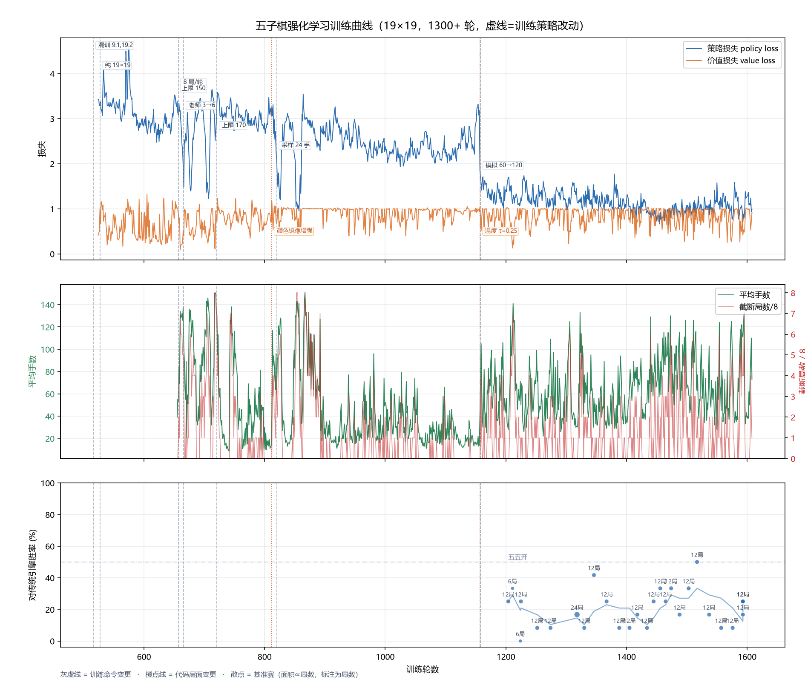

# 训练档案与实验记录

> 这份记录来自远程训练机（4 核 CPU、3.6 GB 内存）的自动存档：**130 份权重快照**、
> 每小时健康巡检、每 2 小时基准赛。每份快照都记录了生成它的完整训练命令，
> 因此可以精确复盘"什么时候改了训练方式、之后发生了什么"。



> 图由 `tools/plot_history.py` 生成：灰虚线是训练命令变更点，橙点线是代码层面改动，
> 三个面板分别是损失、对局质量（手数/截断）、对传统引擎胜率。

## 一、目录结构

```
history/
├── weights/            130 份权重快照（iter00516 ~ iter01363，每 30 分钟一份）
├── index.csv           快照索引：时间 / 轮数 / 棋盘 / loss / 生成它的训练命令
├── timeline.csv        合并时间线：每份快照 + 当时的配置 + 对应巡检指标
├── monitor.csv         每小时健康巡检（单轮耗时、胜负、截断、手数、负载）
├── bench_log.csv       基准赛记录（强化模型 vs 传统引擎）
├── train.log           每轮训练摘要（原始日志）
├── 训练曲线.png        由 tools/plot_history.py 生成的曲线图
└── 阶段表.md           由 tools/build_history.py 自动生成的阶段切分表
```

权重文件名格式：`iter01363_19x19_20261023_0526.pt`（轮数_棋盘_时间）。
加载任意一份即可复现当时的棋力：

```bash
python gomoku/bench_vs_teacher.py --ckpt history/weights/iter01000_19x19_20261022_0800.pt \
       --games 12 --size 19 --sims 60 --time 0.1 --open-moves 4
```

---

## 二、训练方式的七个阶段

阶段由 `index.csv` 里的训练命令自动切分（相邻快照命令不同即视为新阶段），
指标来自 `monitor.csv` 的巡检均值。

| # | 起始时间 | 轮数 | 改动 | 单轮 | 截断 | 平均手数 | loss | bench |
|---:|---|---:|---|---:|---:|---:|---:|---:|
| 1 | 10-20 13:25 | 516 | 混训 9×9:1 + 19×19:2，每轮 12 局，老师 3 局 | — | — | — | 3.84 | — |
| 2 | 10-20 13:55 | 527 | **改成纯 19×19**（目标棋盘） | — | — | — | 4.29 | — |
| 3 | 10-21 03:56 | 657 | 每轮 12 局 → **8 局**，加手数上限 150 | 510 s | 5.0/8 | 138 | 2.46 | — |
| 4 | 10-21 04:56 | 666 | 老师对局 3 → **6 局** | 444 s | 3.8/8 | 106 | 2.84 | 0/12 |
| 5 | 10-21 10:26 | 721 | 手数上限 150 → **170** | 181 s | 1.5/8 | 54 | 3.87 | 0/12 |
| 6 | 10-21 14:26 | 820 | 采样手数 8 → **24** | 248 s | 2.1/8 | 62 | 3.19 | 1/36 |
| 7 | 10-22 04:26 | 1158 | **模拟次数 60 → 120**（+ 采样温度改为 0.25） | 481 s | 1.7/8 | 66 | **1.99** | **25/166** |

### 每一阶段为什么这么改

**阶段 1 → 2（取消混训）**：混训（9×9 占 1/3）的初衷是让 9×9 也能用，但目标是 19×19 的棋力，
混训等于把 1/3 的算力花在非目标分布上。改成纯 19×19 后，每轮样本全部落在目标棋盘。

**阶段 2 → 3（每轮局数减少、加手数上限）**：19×19 上一局可能下到 280 手，单轮跑到 885 秒。
加上限 150 手后单轮稳定在 400~500 秒。代价是**截断率升到 5/8**——这正是后面 bootstrap
问题的来源。

**阶段 3 → 4（老师对局加倍）**：截断局太多，自我对弈里"分出胜负"的样本比例过低。
掺入 6 局传统引擎示范（执黑执白各 3 局）后，bench 局数从 0 变成 12，终于有了可测的结果。

**阶段 4 → 5（上限 150 → 170）**：诊断发现 150 手时"轮到的一方基本都有 VCF"，
抬到 170 让对局多在自然胜负处结束。效果立竿见影：**截断 3.8 → 1.5/8，平均手数 106 → 54**。

**阶段 5 → 6（采样手数 8 → 24）**：当时的猜测是"8 局自我对弈会重放同一盘棋"，
想让更多手带随机性。**这个改动方向是错的**（见第三节第 1 条），真凶是采样温度。

**阶段 6 → 7（模拟 60 → 120，再把温度改成 0.25）**：
唯一一个 loss 明显下降的阶段——policy loss 从 2.27 降到 1.25。其中温度改动起了决定性作用：
同一权重下，温度 1.0 的对局平均只有 12 手，温度 0.25 能下到 36 手。

---

## 三、四条踩坑与纠正（方法记录）

### 1. 温度误判：加"采样手数"没有用

| 改动（同一权重，只改一个量） | 平均手数 |
|---|---|
| 采样前 8 手 @ τ=1.0（基线） | 16 |
| 采样前 24 手 @ τ=1.0 | **12**（反而更短，方向错了） |
| 采样前 24 手 @ τ=0.5 | 20 |
| 采样前 24 手 @ τ=0.25 | **36**（正解） |

**教训**：改参数前先做单变量对照（同一权重、只改一个量）。"采样多少手"和"采得多随意"
是两个独立维度，后者才是决定性的。

### 2. 基准赛的方法性错误：6 局其实只有 2 盘

早期 bench 每 2 小时跑 6 局，结果在 0% 和 16.7% 之间跳。原因：两个 agent 都是**确定性**的
（传统引擎无随机、网络取 argmax），6 局 = 执黑 3 局 + 执白 3 局，各重复 3 遍同一盘，
真实分辨率只有 2 盘。修复后（每局随机 4 手开局、局数提到 12~24）才得到可信的 60 局 20%。

### 3. 截断局的标签：从"和棋"到 bootstrap

截断局最初标 `z=0`（当和棋），价值头因此学会"所有局面都是 0"——value loss 塌到 0.10，
对局全部磨到上限。改成用传统引擎在截断局面的搜索值当目标后，value loss 回到 0.95 左右。
但要注意：85% 的截断局里引擎都能算出强制胜（VCF），所以标签实际是硬 ±1，
这也是后来把上限抬到 170 的动机。

### 4. 颜色偏差不是 bug

一度怀疑"白棋胜率 80% 是禁手规则导致"。做了两组对照：

- **关禁手 vs 开禁手**：各 12 局，都是 3:8——与禁手无关；
- **交换黑白测价值对称性**：40 组，均值 +0.004——价值头是对称的。

结论是弱棋阶段的策略怪癖（谁先手谁赢），应对措施是**颜色镜像增强**（每条样本额外生成
交换黑白的版本），而不是改规则。

---

## 四、三种看数据的方式

1. **看阶段**：`阶段表.md`（自动生成）——训练命令一变就切一段；
2. **看每一轮**：`timeline.csv`——每份快照当时的配置 + 对应巡检指标；
3. **看棋力**：`bench_log.csv`——强化模型对传统引擎的胜率
   （注意 2026-10-22 17:35 之前的记录是确定性重复局，不可比）。

---

## 五、代际对战：训练并不是单调变强的

停机之后做了一件更严格的事——**让最终模型去挑战自己的历史版本**，看训练到底有没有持续进步。
做法：每个对手打 40 局（先手 20 局、后手 20 局，每局随机 4 手开局），4 进程并行。

| 对手轮数 | 执黑 | 执白 | 合计（40 局） |
|---|---:|---:|---:|
| 527（纯 19×19 初期） | 95% | 100% | **97.5%** |
| 657（12→8 局/轮） | 95% | 75% | 85% |
| 721（上限 170） | 100% | 100% | **100%** |
| 820（采样 24 手） | 100% | 90% | **95%** |
| 1158（模拟 120） | 37.5% | 35% | **36%** |
| 1363（模拟 120+τ0.25） | 42.5% | 15% | **29%** |
| 1477（模拟 90 起点） | 25% | 20% | **22.5%** |

**结论一：对 820 及以前的版本几乎全胜（95~100%）**——从"混训 + 60 模拟"到"纯 19×19"那一段的进步是真实的。

**结论二：对 1158 之后的三代反而打不过（22~36%）**——即 **1608 轮不如它 150~450 轮之前的自己**。

## 六、最强权重其实是 1477（已回退）

针对上面这个反常现象，又做了一次小型循环赛（三代之间两两对战，各 24 局）：

| 对局 | 胜率 |
|---|---:|
| 1477 vs 1158 | 62.5% |
| 1477 vs 1363 | 58.3% |
| 1363 vs 1158 | 60.5% |

排名：**1477 > 1363 > 1158**，排名一致、没有循环。

再用同一批 24 个开局让两代直接打传统引擎验证：

| 权重 | 对传统引擎 |
|---|---:|
| **iter 1477** | **10 胜 14 负 = 42%** |
| iter 1608 | 2 胜 22 负 = 8% |

所以**交付权重已从 1608 回退到 1477**（本地与 VM 的 `latest.pt` 都换了）。
这一条是本项目最重要的教训：**"最新"不等于"最强"，只看对固定对手的胜率会被噪声掩盖，
只有让模型和自己比才能看出退化。**

---

## 七、续训与代际闸门（2026-10-28）

确定"1477 是最强"之后，按它续训，并补上了防止再次退化的机制：

| 机制 | 做法 |
|---|---|
| 训练/部署分离 | 训练写 `latest.pt`；部署读 `best.pt` |
| 代际评估 | 每 50 轮让 latest 挑战 best，40 局（黑白各 20，随机 4 手开局） |
| 提升条件 | 胜率 ≥ 55% 才把 latest 提升为 best |
| 退化报警 | 连续 3 次 < 50% → 写 `gate_alert.txt` |
| 饱和判定 | 连续 5 次都在 50%±5% → 标记 saturated（说明该改结构了） |

配置同时从 sims 90 改回 **120**（这是 1477 那代用的配置）。
脚本：`gate.py`（一次评估）、`gate_watch.py`（每 50 轮调度，已并入 watchdog）。

**第一次评估（10-29 00:29，1528 轮）**：latest 1528 vs best 1477，40 局 **16 胜 24 负 = 40%**，
低于 50% → 动作 `LOW(1)`，拒绝替换，`best.pt` 保持 1477。

这条记录说明两件事：

1. 闸门确实在工作——退化版本不会被推上线；
2. **从 1477 续训 50 轮并没有变强**，暗示 1477 附近已经饱和；
   若 1578、1628 两轮仍 <50%，就应改策略（如把 sims 提到 200）而不是继续堆时间。

## 八、第四阶段：加算力实验（2026-10-30 起）

前三轮"战术补漏"（运行时护栏 / 战术兜底 / 定向标注）都验证无效之后，
改用**单变量加算力**：把每步模拟次数从 120 提到 **200**，其余不动。

| 配置 | 单轮耗时 | 速度 |
|---|---|---|
| sims 120 | 400~1100 秒 | 5~7 轮/小时 |
| **sims 200** | **308~734 秒** | **5~6.5 轮/小时** |

有意思的是速度几乎没降——因为搜索变深之后对局质量提高、长局变少，
单局手数下降抵消了每步的额外开销。按这个速度，三天大约能跑 350~400 轮。

预期产出：搜索更深 → 自我对弈标签质量更高 → 如果"整体实力"这条路走得通，
应该会在**代际对战**和对传统引擎的胜率上同时体现；如果三天后仍然原地踏步，
就说明瓶颈不在搜索深度，而在网络容量或评估函数。

## 九、第四阶段结论：64 通道这条线的最终成绩（2026-11-02 封存）

- 训练停在 **2040 轮**，闸门选出的最佳是 **1997 轮**；
- 第 1698 轮起把 sims 提到 200，又跑了 342 轮；
- 对传统引擎：1907 轮 31%、1997 轮（best）同量级，与 1477/1628 的 33% **统计上无差异**；
- 四次尝试（sims↑、降 sims、三种战术补漏、sims 200 长跑）都指向同一结论：
  **30 万参数的网络容量是瓶颈**。

封存内容（仓库外 `模型快照-64ch/`）：
| 文件 | 说明 |
|---|---|
| `archive/` | **401 份权重快照**（516 → 2040 轮，每 30 分钟一份，468 MB） |
| `best_64ch_iter1997.pt` | 闸门选出的最佳权重 |
| `latest_64ch_iter2040.pt` | 停机时的权重 |
| `gate_log.csv` | 12 次代际评估记录 |
| `monitor.csv` / `train_64ch.log` | 巡检与逐轮日志 |
| `archive_index.csv` | 每份快照对应的训练命令 |

仓库内只保留关键记录与两版权重（`history/*_64ch.csv`、`weights/iter01997_*`、`weights/iter02040_*`），
全量 401 份快照放在仓库外的 `五子棋项目\模型快照-64ch\`，避免把 git 撑到 1 GB。

## 十、第五阶段：加宽网络（128 通道 × 4 块，2026-11-02 起）

按"瓶颈在容量"的判断，把网络从 **64 通道加宽到 128 通道**（残差块仍 4 个），
参数量从 30 万涨到约 119 万（4 倍），单步推理成本约 4 倍。

| 项 | 64ch | 128ch |
|---|---|---|
| 参数量 | 298,246 | 1,186,054 |
| 每步模拟 | 200 | 120 |
| 预期速度 | 4.4 轮/小时 | 约 1.2~1.5 轮/小时 |

为了不让速度掉太狠，模拟次数回落到 120（就是产出 1477 那代峰值时的配置）。
**但不需要从零开始。** 用 `widen.py` 做了**函数保持的加宽**（net2net）：
旧 64 通道的权重装进新网络的前 64 个通道，新增通道的卷积权重和 BN 的 gamma 置零
（因此恒输出 0，不影响结果）。验证结果：

| 检查 | 数值 |
|---|---|
| 策略输出最大差 | 3.8e-6（本机）/ 0.0（VM 上同一权重自比） |
| 价值输出最大差 | 6.0e-8 |

也就是说加宽后的网络在初始时刻**和旧模型逐位等价**，训练直接从 1997 轮的水平接着走。

效果对比（同一套 128 通道配置）：

| 初始化方式 | 首轮 loss（policy） | 单轮耗时 |
|---|---|---|
| 随机初始化 | 7.85（policy 6.74） | 950~1400 秒 |
| **从 1997 轮加宽** | **2.11（policy 1.10）** | **459 秒** |

不只是起点高，速度也快一倍以上——因为模型棋力还在，对局不会拖到 110 手。

## 十一、训练停机与最终状态

**2026-10-24 22:0x 停止训练**，最终状态：

| 项 | 值 |
|---|---|
| 训练跑到 | 1608 轮（20 万参数网络、19×19、每轮 8 局自我对弈） |
| **交付权重** | **iter 1477**（对传统引擎 42%，比 1608 的 8% 高 5 倍） |
| 累计对局 | 约 1.3 万局自我对弈 + 约 900 局老师陪练 |
| 停机理由 | 三组局部规则干预都试过（见报告 3.3），且代际对战显示 1158 之后开始退化 |

停机顺序：先停看门狗（否则会自动拉起训练）→ 停训练 → 停巡检与存档 → 取回全部权重与日志。
VM 上的训练进程现已全部退出，只剩系统本身。

## 十二、改动验证协议（2026-11-03 加入）

这个项目被小样本骗过两次（6 局其实是同一盘棋、24 局分不清 33% 和 42%），
所以后来所有"改参数/改结构"都走同一套验证：

| 步骤 | 工具 | 判据 |
|---|---|---|
| 1. 自对弈 vs 当前最佳 | `compare.py --pairs 20`（40 盘，黑白互换） | 95% 置信区间**下界 > 50%** 才算变强 |
| 2. 对传统引擎 | `bench_vs_teacher.py --games 36` | 不低于当前最佳 10 个百分点 |
| 3. 结论不足就加局数 | 同上，参数加倍 | 绝不用"感觉"代替数据 |

`compare.py` 的关键设计：

* **成对开局**：每个开局下两盘（黑白互换），抵消开局本身的强弱；
* **bootstrap 95% CI**：对每个开局的得分差重采样 2000 次；
* **三分结论**：显著更好 / 显著更差 / **无法区分**——最后一种会明确提示"需要更多局数"。

示例（4 个开局、每步 30 次模拟，只是冒烟测试）：

```
基线 1997  vs  候选 1477
开局 4 个 / 对局 8 盘
候选得分率 62.5%  95% CI [25.0%, 100.0%]
结论：无法区分——需要更多局数，别把噪声当进步
```

这次的教训直接催生了这个工具：**"改动前先验证，验证要带置信度"**。

## 十三、结论：加宽有效（2026-11-05）

128 通道从 1997 轮热启动，跑到 **2148 轮**时闸门第一次通过（自对弈 57.5%），
随即用 36 局打传统引擎：

**注意：这一段最早写的是 61%，后来发现是 36 局的样本偏差。以下是统一用 48 局
（同一批开局、同样的 sims 60）复测的准确数字：**

| 权重 | 参数量 | 对传统引擎（48 局） |
|---|---:|---:|
| 64ch @ 1997 | 30 万 | **29%（14 胜 34 负）** |
| 128ch @ 2148 | 119 万 | **40%（19 胜 29 负）** |
| 128ch @ 2208（对抗训练后） | 119 万 | **35%（17 胜 31 负）** |
| 128ch @ 2298（对抗训练更久） | 119 万 | **44%（21 胜 27 负）** |
| **128ch @ 2358（当前最佳）** | 119 万 | **50%（24 胜 24 负）** |

**加宽的收益是 +11 个百分点（29% → 40%），是真实的，但远没有 36 局那次显示的那么大。**
2148 的 36 局是 61%（22/36），48 局就回落到 40%——这已经是本项目第五次被小样本坑。

这也再次说明：**判断"某改动是否有效"必须 ≥48 局、且同一批开局、同样的对手设置。**

### 后续进展（128ch + 混合对抗训练）

| 权重 | 对引擎（48 局） | 说明 |
|---|---:|---|
| 64ch @ 1997 | 29% | 加宽前 |
| 128ch @ 2148 | 40% | 加宽后（尚无对抗训练） |
| 128ch @ 2208 | 35% | 对抗训练 38 轮 |
| 128ch @ 2298 | 44% | 对抗训练 ~130 轮 |
| **128ch @ 2358** | **50%** | 对抗训练 ~190 轮 |

**累计 +21 个百分点（29% → 50%）。** 但要注意：单次之间的差异都在噪声内
（48 局约 ±14%），可信的是**趋势**。

同样要诚实记录：**输局的形态没有变**。2358 的 20 局诊断里，12 盘输棋有 11 盘仍在
**30 手以内**，4 盘在最后 3 手内漏挡活三。也就是说：

> 胜率在涨，但"开局被战术打死"这个习惯**并没有被治好**——
> 提升来自整体棋力的增强，而不是那个具体短板的修复。

过程中的闸门记录（说明"加宽需要先破坏再重建"）：

| 轮数 | 自对弈胜率 | 动作 |
|---|---:|---|
| 1998 | 50.0% | 等价起点 |
| 2028 | 40.0% | 低迷 |
| 2058 | 30.0% | 低迷 |
| 2088 | 25.0% | **报警（连续 3 次）** |
| 2118 | 40.0% | 低迷 |
| **2148** | **57.5%** | **PROMOTE** |

150 轮里先掉到 25%、再冲到 57.5%——旧权重被"撑开"到新容量后，需要重新组织表征。
闸门在最低谷时挡住了替换，`best.pt` 一直安全。

## 十四、第六阶段：混合对抗训练（2026-11-04 起）

诊断结论：模型输给引擎的局**全部在 35 手内**，且每一次都有"对手活三可挡但没挡"的机会
（复盘两局都是这样）。而纯自我对弈**给不出纠正这个习惯的梯度**——两个同源模型共享同一个盲区，
不挡的一方不会因此受罚，训练反而在奖励"抢攻"。

于是加入**混合对抗训练**（DAgger 式）：

| 项 | 做法 |
|---|---|
| 对抗局 | 每轮 6 局模型 vs 传统引擎（黑白各半，随机 4 手开局） |
| 状态来源 | **模型自己走出来的局面**（会主动踩进它的盲区） |
| 动作标签 | **引擎在这一手的着法**（专家示范） |
| 结果标签 | 真实胜负 z（输棋的位置拿 -1） |
| 混入比例 | 每批样本 25% 来自对抗池（单独的 deque，上限 3000） |

这样梯度里第一次出现"**你在这里不挡，然后你输了**"的信号。

第一个完整轮次：6 局 → 97 个位置样本，库存 776；单轮耗时 1492 秒（约 25 分钟）。

**顺带修了一个致命 bug**：看门狗把"25 分钟没有新轮次"判定为卡死并重启训练。
改成 128 通道 + 对抗陪练后单轮就要 20~25 分钟，阈值太紧会把正常训练反复杀掉
（实际上已经杀过一次）。已把阈值放宽到 **45 分钟**。

## 十五、复现方式

```bash
# 重新生成阶段表与时间线
python tools/build_history.py

# 用任意一份历史权重打基准赛
python gomoku/bench_vs_teacher.py --ckpt history/weights/iter01000_19x19_20261022_0800.pt \
       --games 12 --size 19 --sims 60 --time 0.1 --open-moves 4
```
